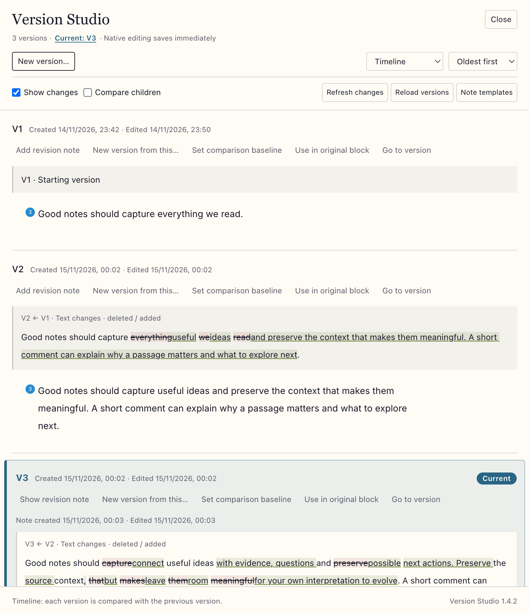
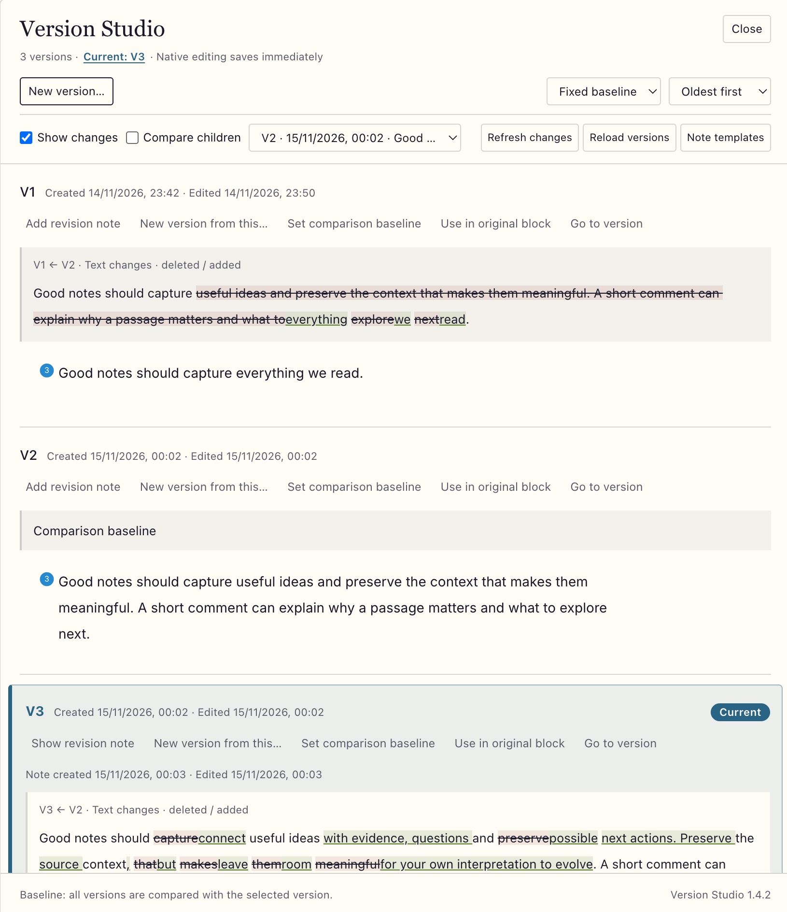
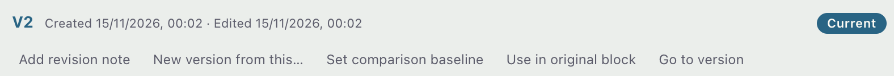
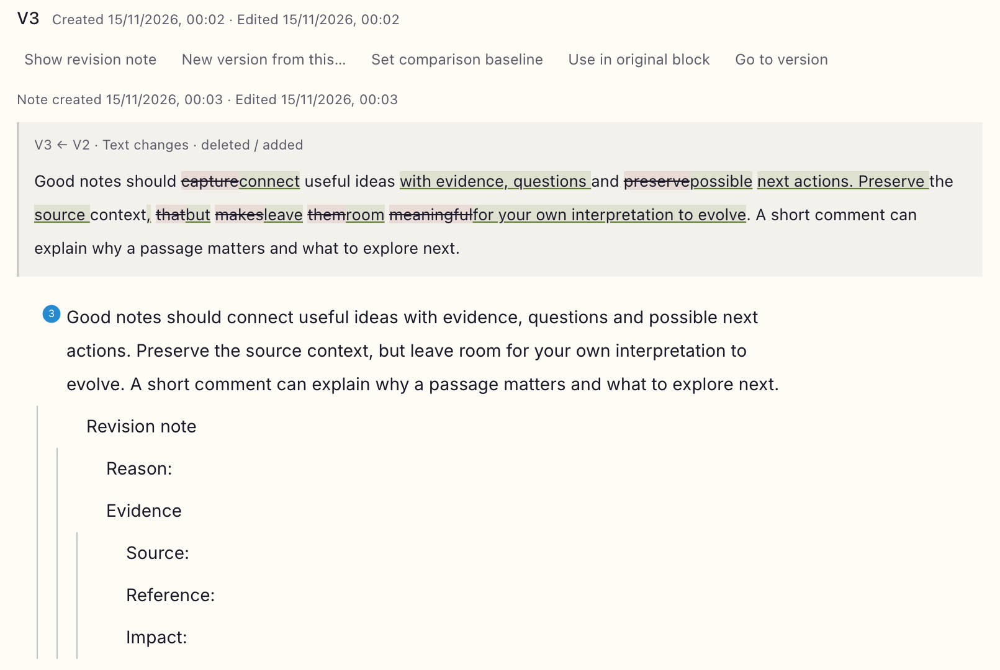

# Version Studio

**Keep writing from an existing idea, and see every change clearly.**

Roam's quick versions are ideal for keeping different expressions of the same idea. I often use them to try another wording, reshape an argument or temporarily retain several directions I have not yet chosen between. As the versions multiply, though, switching through them one by one makes comparison and organisation harder.

More importantly, when we revise an idea, we usually already have a starting point. It might be a draft we have just finished, or an earlier version that is closer to what we now want to say. I wanted to find that version and keep working from its text while preserving the other attempts. That is why I made Version Studio.

Version Studio brings a block's native versions into one panel, connecting browsing, comparison, selection and continued rewriting in a single workflow.

## See different versions together

Open the panel to browse versions in chronological order, or work backwards from the newest. The version currently displayed on the original page is clearly marked, helping you find your place among several drafts.

Choose between two ways of comparing them:

### Timeline comparison

Compare each version with the one before it.

Follow the text from its first expression to the present, seeing what was added or removed at each step and how the thinking gradually changed.

### Fixed-baseline comparison

Choose any version as a common baseline and see how the others differ from it.

This is useful for comparing drafts that explore different directions and deciding which best fits your current thinking.

Added and deleted text is marked directly. You can also include child blocks in the comparison when needed.

## Continue from the version that fits best

Once you find a version worth developing, edit it directly or create a new version from it. The new version starts with the original text, with an option to copy its content child blocks as well, so you can continue adding to and reshaping the existing structure.

You can also make a version the one currently displayed on the original page while retaining the others. If an earlier expression turns out to fit better, return to that starting point and keep writing.

Direct edits save to the version you are editing. If you want to preserve its earlier wording too, create a new version first.

## Record why you made a change

Sometimes the final text does not fully explain the thinking behind it. Version Studio therefore provides a revision-note template for recording reasons, evidence, references and impact. Adapt the template to your own way of documenting changes, for example:

- What problem am I trying to solve with this revision?
- What evidence changed my judgement?
- What still needs revision?
- What should I verify or add next?

These notes are saved under the corresponding version, so you can revisit the textual changes alongside the thinking that informed them.

Right-click a block bullet and choose **Version Studio…** to begin. The plugin uses Roam's native versions and editor, preserving the familiar page links, block references and outline operations.

Interface translations and documentation are available in English, Chinese, Italian, German, French and Spanish. See [Version Studio's GitHub page](https://github.com/DelmarHuang/roam-version-studio) for detailed features and instructions, including the [full manual](https://github.com/DelmarHuang/roam-version-studio/blob/depot-submission-2026-11-15/docs/GUIDE.md).
